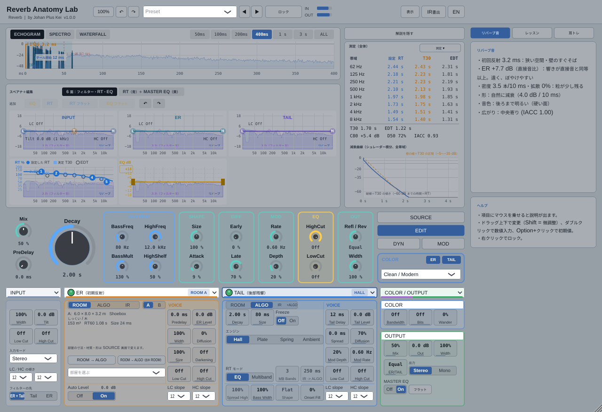
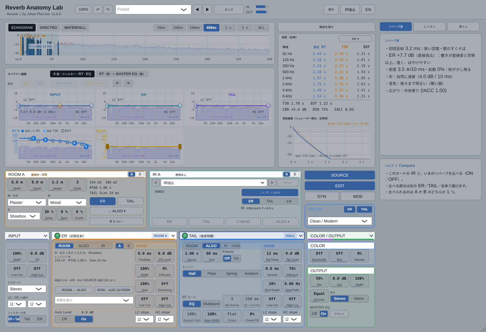

# Reverb Anatomy Lab（JUCE プラグイン）

by Johan Plus Kei — リバーブの中身を「組み立てて・見て・聴いて」学べる VST・AU 対応プラグイン（VST3 / AU / Standalone）。初期反射（ER）と残響（TAIL）を別々に作り、部屋・IR・アルゴリズムの違いを数値と図で確かめられます。





## ⬇️ ダウンロード / Download

**[最新版をダウンロード / Download latest](https://github.com/kazufumi01/ReverbAnatomyLab/releases/latest)** — 無料配布中 / Free

| | 手動インストール（おすすめ） | インストーラー |
|---|---|---|
| **Mac**（macOS 11+, Apple Silicon / Intel） | `ReverbAnatomyLab-1.0.0-mac.zip` | `ReverbAnatomyLab-1.0.0-mac.pkg` |
| **Windows**（10 / 11, 64bit）⚠️未検証 | `ReverbAnatomyLab-1.0.0-win64.zip` | `ReverbAnatomyLab-1.0.0-win64.exe` |

- インストール方法：**[INSTALL.md](INSTALL.md)**（日本語 / English）
- ⚠️ **Windows 版は実機での動作確認ができていません**（自動ビルドで作成。VST3 と Standalone）。 / The Windows build is untested on real hardware.
- Apple の公証・Windows のコード署名をしていないため、初回のみ警告が出ます。
- 不具合・要望は [Issues](https://github.com/kazufumi01/ReverbAnatomyLab/issues) へ。

---

## 主な機能

- **ER と TAIL を別々に組み立てる**
  - ER の元：ROOM（寸法・壁と床の材質・形・散らかり具合）／ALGO（パターン）／IR
  - TAIL の元：ROOM／ALGO（Hall・Plate・Spring・Ambient）／IR／IR＋ALGO（頭だけ IR）
  - 部屋は箱のほか、扇形・傾いた壁・ドーム・連結（二重勾配）・廊下。ROOM A / B と IR A / B を持ち、ER と TAIL へ別々に送れる
  - 周波数ごとの残響時間（RT）、立ち上がり（Onset Fill・Spread）、Bass / High の減衰、Diffusion、モジュレーション
- **見る**：エコーグラム／スペクトログラム／ウォーターフォール、スペアナ上で INPUT・ER・TAIL のフィルター、RT、MASTER EQ を 6 面で比較、測定表（T30・EDT・C80・D50・IACC）、部屋の平面図、IR 解析
- **IR を扱う**：L / R の組（`名前_L`／`名前_R` など）を自動判別して読み込み、IR → アルゴリズムの変換（フィット）、IR の比較、IR の書き出し、フォルダー一括からのプリセット作成
- **DYN / MOD**：ダッキング（Single / Multi / Spectral）・ゲート、LFO ×2・エンベロープ・コーラス・変調マトリクス
- **COLOR**：時代ごとのプリセット（Bandwidth / Bits / Wander）
- **レッスン**（設定の読み込み付き）と**耳トレ**、プリセット（用途別・IR フィット）とユーザープリセット、◀ ▶ で順送り、パラメーターロック
- 配色、表示（文字の濃さ・明るさ・コントラスト）、日本語 / English

---

## ビルド

```bash
./build.sh            # 手元の JUCE（~/Documents/jpkplugins/JUCE）を使う。無ければ CMake が JUCE 9.0.4 を取得
```

- Windows は GitHub Actions（`.github/workflows/build-win.yml`、手動実行）で VST3 / Standalone をビルドし、Inno Setup でインストーラーを作成
- Mac のインストーラー作成：`packaging/mac/build_pkg.sh [version]` ／ `packaging/mac/build_zip.sh [version]`（出力は `dist/`）

## ライセンス

JUCE は **Starter ライセンス** で使用。配布物はフリーウェア使用許諾（`packaging/mac/resources/license.txt`）に従います。
ソースは学習目的で公開していますが、無断での再配布・販売はできません。

---

**Johan Plus Kei** — [Spotify](https://open.spotify.com/artist/30PV2gqUbDDwvuWtKaok0x) ・ [Apple Music](https://music.apple.com/us/artist/johan-plus-kei/519360150) ・ [X](https://x.com/johanpluskei) ・ [Instagram](https://www.instagram.com/johanpluskei) ・ [Learning labs](https://kazufumi01.github.io/)

## Support / 支援

Reverb Anatomy Lab is free. If it helps your mixing or your classes, you can support development with a one-time tip via [PayPal](https://paypal.me/johanpluskei). More ways to help: <https://kazufumi01.github.io/support/>

Reverb Anatomy Lab は無料です。ミックスや授業で役立ったら、[PayPal](https://paypal.me/johanpluskei) からの投げ銭で開発を支えていただけるとうれしいです。
